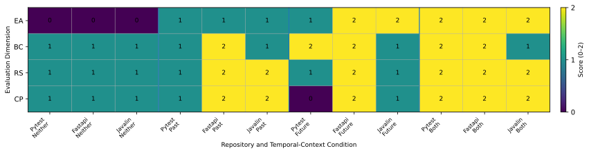

#### Temporal Notes Generation

Temporal notes are generated from the raw issue thread and release-window evidence as evolution-only context, while excluded artifacts are used to remove implementation-level details.

#### Temporal Notes Verification

Final agent prompts are generated by a Python script according to each temporal-context condition, then checked again with the leakage audit for implementation-detail leakage.

#### Patch Behavior Rubric Scores by Temporal-Context Conditions

Overall, temporal context improves patch behavior, with the Both condition showing the clearest gains, especially on EA (Evolution Awareness).

